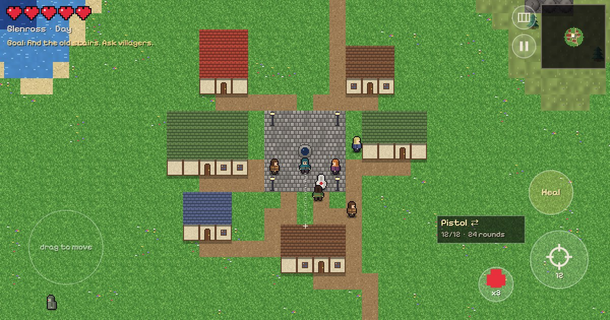

# Beneath the Skin

*Something beneath the world is hunting you, and turning it into a prison.*

**▶ Play it: https://ronan-francis.github.io/beneath_the_skin/**



A pixel-art horror hunt that runs in the browser, on desktop or phone. You have tracked the Shift across three islands. This time you got here before it woke. Find the old stairs, go down, and kill it.

Every world is generated from a seed: a wrapping island of hex regions with towns, cities, deserts, swamps and mountain lakes. Below it are maze floors that grow more alive the deeper you go, and at the bottom is the inside of the Shift itself.

## Features

- **Procedural worlds.** Overworld, towns, houses, mazes and the flesh level are all built from one seed. Type a seed on the title screen to replay a world.
- **Day and night.** The Shift stalks the surface after dark.
- **Four difficulties:** Easy, Medium, Hard and Impossible.
- **Scavenging.** Search empty houses and bodies for guns, ammo, medkits and recovered files.
- **Synthesized sound.** Every effect and the heartbeat are generated live with Web Audio. There are no sound files.
- **Plays offline.** After one visit, the game works with no connection.
- **Installable.** Add it to your phone's home screen and it opens full screen, like an app.
- **Easy to pick up.** One-time tips appear next to each control the first time you need it, things you can use sparkle when you're close, and *How to play* (title screen or pause menu) covers the rest.
- **Built-in world tests.** *World tests* on the title screen generates 50 worlds and checks that every one is playable.

## Controls

| Action | Touch | Keyboard |
| --- | --- | --- |
| Move | Drag with your left thumb | WASD / arrow keys |
| Attack / shoot | Crosshair button | Space or J |
| Use, talk, search, climb | Context button (its label changes) | E or Enter |
| Switch weapon | Tap the weapon panel | Q |
| Reload | | R |
| Use a medkit | Red cross button | H |
| Map | Map button | M |
| Pause | Pause button | Esc or P |

Opening the map pauses the game. On a phone, hold it sideways. In Chrome, use ⋮ → **Add to Home screen** to play full screen.

## Running it on your computer

The game uses JavaScript modules, which browsers won't load from a double-clicked file, so serve the folder:

```bash
python -m http.server 8000
```

Then open http://localhost:8000. There's no build step and nothing to install.

On `localhost` the game always loads fresh copies of every file and the offline service worker is switched off, so your edits show up on a normal reload without touching `VERSION`. To test it exactly like the live site, offline mode included, open http://localhost:8000/?sw.

## Publishing an update

1. Open `index.html` and bump `VERSION` (for example `'1'` → `'2'`).
2. Commit and push to `main`. GitHub Pages redeploys within a minute or two.

Every file URL includes `?v=VERSION`. Bumping it makes browsers, and the offline cache, fetch the whole new set together, so nobody ends up with half-old, half-new files. If you add a new file to `js/`, also add its name to `GAME_MODULES` in `index.html`.

## Project layout

```
index.html              page markup, VERSION, import map, offline registration
css/style.css           menus and overlays
sw.js                   offline service worker
manifest.webmanifest    home-screen install settings
icons/                  favicon and app icons
preview.jpg             link-preview image (Discord, WhatsApp, etc.)
js/
  core.js               shared helpers, random numbers, tile types, the Level class
  difficulty.js         difficulty settings and villagers' hints toward the stairs
  noise.js              Perlin / value noise for terrain
  art.js                ALL procedural pixel art: tile painters, colours, sprites
  entities.js           movement and collision, enemy and NPC definitions, enemy pathing
  gen_overworld.js      the surface: terrain, biomes, roads, hex regions, towns and cities
  gen_maze.js           the maze floors, and moving between levels
  gen_flesh.js          the final level inside the Shift
  gen_house.js          house interiors
  shift.js              the Shift hunting you on the surface at night
  guide.js              telling the player what to do next, and the How to play page
  worldchecks.js        world validation, auto-fixes and the World tests page
  audio.js              synthesized sound effects and heartbeat
  weapons.js            guns, ammo, files, searching houses and bodies, pick-up pop-ups
  tips.js               one-time tips that point at a control the first time it matters
  game.js               canvas, input, game state, update loop, rendering, HUD, saves, menus
```

The entry point is `js/game.js`. Each file imports only what it uses from the others.

### Changing the art style

Nearly all the visuals come from **`js/art.js`**:

- `C` and `PAINT`: the colours and painter functions for every tile type (grass, water, walls, maze, flesh…)
- `buildAtlas`: assembles the painted tiles into the tile sheet
- `buildSprites` and `PALS`: characters, enemies and items, with their colour palettes

Lighting, fog and the HUD are drawn in `js/game.js` (`drawLighting`, `drawFog`, `drawHUD`).

## Saves

Progress, and which tips you've already seen, are saved in the browser's local storage under keys starting with `beneath_the_skin`. Saves belong to the site they were made on, so a save from `localhost` doesn't carry over to the GitHub Pages version. *Clear all saves* on the title screen wipes them.
